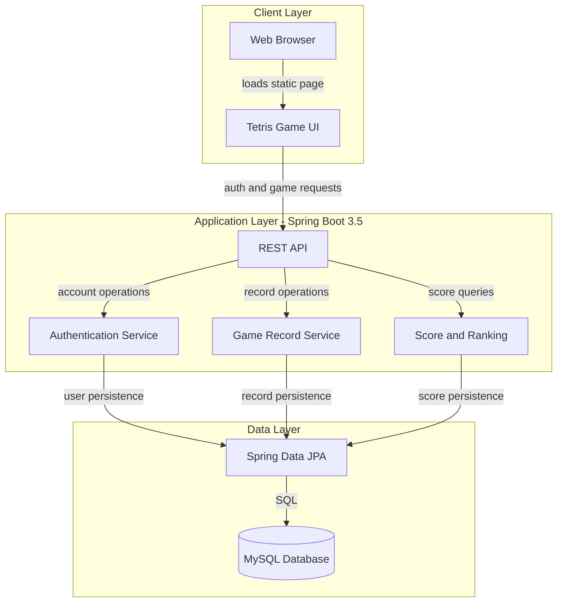
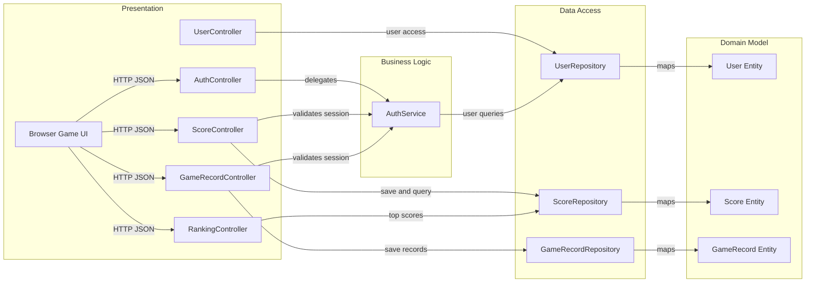

# 俄羅斯方塊專案架構圖

本專案是一個以瀏覽器操作的俄羅斯方塊遊戲，採用單頁前端搭配 Spring Boot REST API。遊戲狀態在瀏覽器即時運算，登入後可將分數與遊戲紀錄保存到 MySQL，並透過排行榜 API 查詢成績。

## Application Architecture

<!-- mermaid-checked: no \n, no em-dash/en-dash, no {} in labels, subgraphs are id["label"], arrows are -->|"label"|, all subgraphs closed by end, ids unique -->

### Technology Stack Summary

| Layer | Technology | Version | Purpose |
|---|---|---:|---|
| Client | HTML, CSS, JavaScript | Browser standard | 遊戲介面、棋盤繪製、鍵盤與按鈕操作 |
| Client | Canvas API | Browser standard | 顯示棋盤、方塊與下一個方塊 |
| Application | Spring Boot | 3.5.16 | 建立 Web 應用程式與 REST API |
| Application | Spring MVC | Spring Boot managed | 處理 HTTP 請求與 JSON 回應 |
| Application | Spring Data JPA | Spring Boot managed | Repository 與 ORM 資料存取 |
| Application | Jakarta Validation | Spring Boot managed | 驗證帳號與遊戲資料 |
| Data | MySQL Connector/J | Runtime dependency | 連接 MySQL 資料庫 |
| Build | Maven Wrapper | Project managed | 編譯、測試與啟動 Spring Boot |

### Data Storage and External Services

資料儲存使用 MySQL，主要保存使用者、分數與遊戲紀錄。專案沒有使用快取、訊息佇列或第三方 API；登入 session 目前由後端程序記憶體中的 ConcurrentHashMap 管理，因此重新啟動後既有 token 不再有效。前端透過同源 REST API 呼叫後端，適合本機或暫時隧道測試。

### Key Architectural Decisions

- 採用前後端同源部署，Spring Boot 同時提供靜態首頁與 REST API，降低測試部署複雜度。
- 使用 Controller、Service、Repository、Entity 分層，將 HTTP、業務邏輯與資料存取分開。
- 遊戲核心邏輯在瀏覽器執行，後端只保存登入資訊、分數與遊戲結果，減少遊戲操作延遲。

## Component Relationships

<!-- mermaid-checked: no \n, no em-dash/en-dash, no {} in labels, subgraphs are id["label"], arrows are -->|"label"|, all subgraphs closed by end, ids unique -->

### Component Inventory

| Component | Layer | Type | Responsibility |
|---|---|---|---|
| Browser Game UI | Presentation | Static HTML and JavaScript | 執行遊戲迴圈、碰撞判定、消行、計分與 API 呼叫 |
| AuthController | Presentation | REST Controller | 註冊、登入、重設密碼、目前使用者與登出 |
| ScoreController | Presentation | REST Controller | 保存分數與查詢目前使用者的成績 |
| RankingController | Presentation | REST Controller | 提供前 20 名排行榜 |
| GameRecordController | Presentation | REST Controller | 保存與查詢遊戲紀錄 |
| UserController | Presentation | REST Controller | 提供使用者相關 API |
| AuthService | Business Logic | Service | 驗證帳號、建立 session token、處理密碼雜湊 |
| UserRepository | Data Access | JPA Repository | 使用者查詢與保存 |
| ScoreRepository | Data Access | JPA Repository | 分數查詢、排序與保存 |
| GameRecordRepository | Data Access | JPA Repository | 遊戲紀錄查詢與保存 |
| User | Domain Model | JPA Entity | 使用者帳號與認證資料 |
| Score | Domain Model | JPA Entity | 分數、消除行數、等級與建立時間 |
| GameRecord | Domain Model | JPA Entity | 遊戲結果、分數、等級與遊玩時間 |

## 專案大略簡述

這是一個具備基本帳號系統與成績保存功能的網頁版俄羅斯方塊。使用者可直接開始遊戲，也可以註冊或登入帳號；遊戲結束時，前端會將分數與遊戲紀錄送到後端。系統另外提供個人成績與公開排行榜，適合作為前端互動、REST API、Spring Boot 分層設計與資料庫整合的示範專案。

### 主要功能

- 俄羅斯方塊七種方塊、旋轉、移動、加速下落與直接落底
- 分數、等級、消除行數與最高分顯示
- 使用者註冊、登入、登出與密碼重設
- 登入後保存分數與遊戲紀錄
- 個人成績與前 20 名排行榜
- Spring Boot 靜態頁面與 API 同源提供
